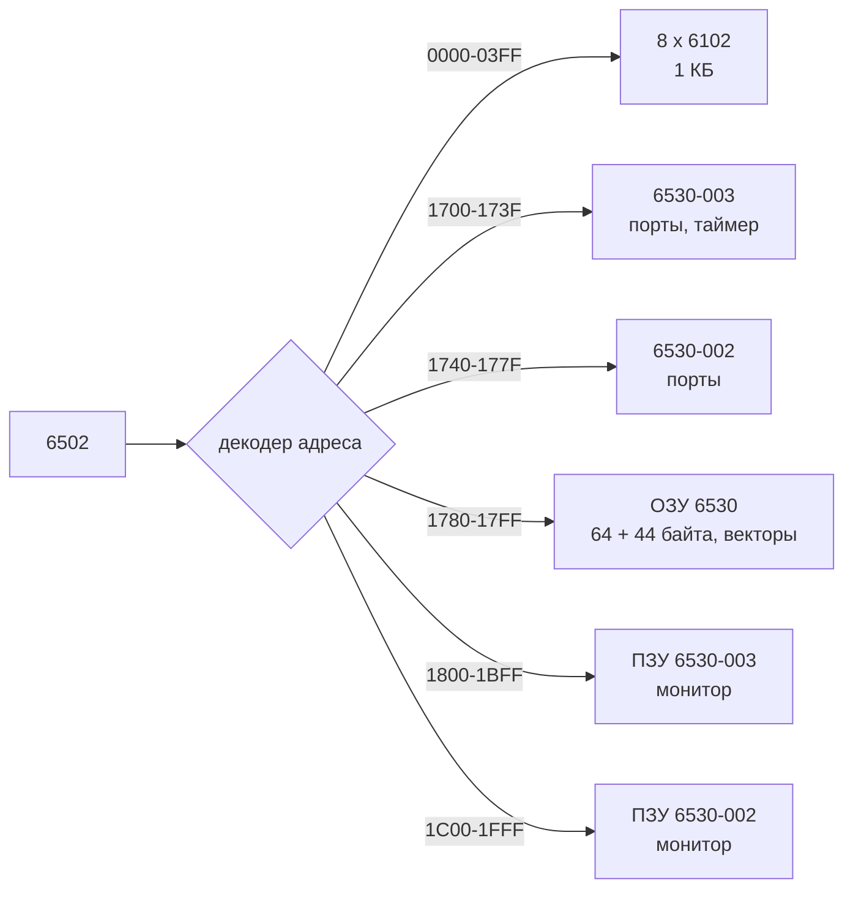

# Результат: Haiku 5.5, эффорт medium

## 1. Новый текст подраздела М4.6

````markdown
## М4.6 — KIM-1 (1976)

<!-- ПРИМЕЧАНИЕ:
Бывший Д4а (часть про KIM-1) — теперь обязательный подраздел основной линии.
Цель: одноплатный компьютер на MOS 6502 с монитором в ПЗУ, шестиразрядным семисегментным индикатором, клавиатурой, кассетным и телетайпным интерфейсами. Главная идея для эмулятора: состояние машины почти целиком держится на двух микросхемах 6530 (ПЗУ, ОЗУ, порты и таймер в одном корпусе), а монитор сам выводит цифры на индикатор и сам опрашивает клавиатуру. Эмулятор KIM-1 — это ядро 6502, карта адресов, модель 6530 с портами и таймером, индикатор, клавиатура и поток байт для телетайпа и кассеты.
Плоскость: «применить». Читатель уже реализовал 6502 (М3.4) и видел Apple I (М4.1): здесь он строит машину по адресной карте, а не по готовой схеме.
Опора: М3.4 (ядро 6502, адресация, прерывания RESET/NMI/IRQ, BRK); М4.1 (шина и монитор Apple I, кассетный интерфейс); М1.10 (функциональная шина, memory map, MMIO); М0.4.11 (декодеры и зеркала адресов); М0.4.13 (память, статическое и динамическое ОЗУ); М0.4.14 (шина и open bus); М0.4.17 (ввод-вывод на уровне схем); М0.3.20 (логические уровни); справка «KIM-1» (М0.1.17.06).
Граница:
- История машины, значение и упоминания людей — справка М0.1.17.06; биографии — М0.1.25.
- Ядро 6502 и его циклы шины — М3.4; здесь — только то, что видно по адресам KIM-1.
- Звук и графическое окно не эмулируются; вывод — текстовый терминал и файлы (М4).
- Контроллер прерываний и приоритеты — будущий подраздел из бывшего Interrupt Lab; здесь — только векторы KIM-1.
- Семисегментный индикатор как схема (сегменты, аноды, катоды) — М0.4.17; здесь — программная модель динамической индикации.
Вперёд: М4.7 (TRS-80 — тоже Z80-машина с ПЗУ и кассетой, сравнение интерфейсов); М4.8.04 (телетайп на PDP-8); М5 (Apple II и Commodore — полноценный видеовывод на тех же идеях); М4.10 (арбитраж и wait states на шине).

Структура:
- 01–03 — машина в целом: состав, адресная карта, ОЗУ на 6102.
- 04–06 — микросхема 6530: ПЗУ, ОЗУ, порты, интервальный таймер.
- 07–10 — периферия и монитор: индикатор и клавиатура, монитор и векторы, кассета, телетайп.
- 11 — эмуляция KIM-1 в Go.

Сквозная линия: адресная карта KIM-1 (уроки 02, 04–06, 08, 11). Сравнительные машины: Apple I (М4.1) — тот же 6502 без 6530, ввод-вывод отдельными микросхемами (см. М4.1.02); TRS-80 (М4.7) — ПЗУ BASIC и кассета. Программы в практике — собственные, написанные читателем под адресную карту. Монитор KIM-1 как образ ПЗУ в практику не включается (см. «Для генерации»).

Исправлено относительно прежней версии:
- Подраздел расширен с 4 до 11 уроков. Прежние уроки: «01. KIM-1 как одноплатный компьютер» → урок 01; «02. Микросхема 6530» → урок 04; «03. Индикатор и клавиатура» → урок 07; «04. Эмуляция KIM-1» → урок 11. Новые уроки 02, 03, 05, 06, 08, 09, 10 добавлены между ними; прежний порядок уроков сохранён.
- Прежние пункты сохранены дословно: «KIM‑1: 6502 + LED-дисплей + клавиатура, минималистичный одноплатник», «Место KIM-1 среди первых микрокомпьютеров», «ПЗУ, ОЗУ и порты в одной микросхеме», «Интервальный таймер», «Программное сканирование индикатора», «Сканирование клавиатуры», «Модель машины», «Телетайпный режим», «Запуск монитора и программ».
- Исправлено: «24-клавишная клавиатура калькуляторного типа» — по руководству MOS (Разд. 4.1, стр. 43) на клавиатуре 23 клавиши и один движковый переключатель; число 24 — из рекламы (Wikipedia «KIM-1»). Расхождение записано в уроке 07, а не выбрано молча.
- Исправлено: «мембранная шестнадцатеричная клавиатура — у Synertek SYM-1» не подтверждена проверенными источниками; утверждение удалено.
- Уточнено: «1152 байта (1024 в восьми 6102 плюс ОЗУ микросхем 6530)» — верно; добавлено разложение 8 × 1024 бит = 1024 байта и 2 × 64 = 128 байт.
- Уточнено: «шесть семисегментных индикаторов» — четыре разряда показывают адрес, два — данные (руководство, Гл. 2.4, стр. 9).

Проверенные факты (подробно — в полях уроков):
- Реклама в BYTE, апрель 1976 года; цена 245 долларов США (Wikipedia «KIM-1»).
- MOS 6502 работает на 1 МГц; на плате кварц 1 МГц (руководство, Гл. 1, стр. 2; Разд. 3.1, стр. 22).
- ОЗУ пользователя — блок K0, адреса 0000–03FF, восемь 6102 (1024 × 1 бит); ещё два ОЗУ по 64 байта внутри 6530; всего 1152 байта при рекламных «1 K BYTE RAM» (руководство, стр. 35; Wikipedia «KIM-1»).
- ПЗУ монитора — две микросхемы 6530 по 1024 байта, всего 2048 (руководство, Разд. 3.1, стр. 22; Wikipedia «KIM-1»).
- Адреса: ПЗУ 6530-003 — 1800–1BFF (блок K6), ПЗУ 6530-002 — 1C00–1FFF (блок K7); ввод-вывод 6530-003 — 1700–173F, 6530-002 — 1740–177F; таймер 6530-003 — 1704–170F; векторы — 17FA–17FF: NMI 17FA/17FB, RST 17FC/17FD, IRQ 17FE/17FF (руководство, стр. 35–36; Рис. 3.12, стр. 38; Рис. 3.13, стр. 39).
- Резерв монитора в нулевой странице — 17 адресов 00EF–00FF (руководство, Разд. 3.2, стр. 36).
- Клавиатура — 23 клавиши и один движковый переключатель (руководство, Разд. 4.1, стр. 43); в рекламе — 24 клавиши (Wikipedia «KIM-1»). Расхождение записано.
- Шесть разрядов индикатора: четыре — адрес, два — данные (руководство, Гл. 2.4, стр. 9).
- Телетайп: скорость подбирается по первому нажатию [RUB OUT] после сброса; примеры — 10, 15, 30 символов в секунду (руководство, Гл. 2.6, стр. 17). Телетайп — Teletype Model 33 ASR (Wikipedia «KIM-1»).
- Кассета: 134,2 бит/с, тоны 3700 Гц и 2400 Гц (Wikipedia «KIM-1»; в доступном фрагменте руководства не подтверждено — Приложение E не получено).
- Таймер 6530: делители 1, 8, 64, 1024 выбираются по младшим битам адреса записи (исходник MAME mos6530.cpp, вторичный источник; сверка с даташитом не выполнена).
- Разработчик KIM-1 — Джон Мэй (John May) по Wikipedia; первоисточником не подтверждено.
- Преемники: AIM-65 (Rockwell, 1978), SYM-1 (Synertek) (Wikipedia «KIM-1»).

Для генерации:
- Состав каждого урока: зачем это эмуляторщику (1–2 абзаца) → секции по пунктам прежней версии и новым темам → пример из KIM-1 с адресами и числами → «Что это значит для эмулятора» → типичные ошибки → упражнения с ответами в поле «Практика».
- Изобразительные средства: адресная карта — Markdown-таблица и Mermaid `flowchart`; состояние таймера и тайминги — блок текстовый блок; переходы монитора — Mermaid `stateDiagram-v2`. Фото — в `media/` урока, с записью в `media/credits.toml`.
- Адреса в таблицах — в записи руководства (`1800`, `17FA`), без `$`; в тексте программ `$1800` допустим, одиночный `$` движок не считает формулой.
- Монитор KIM-1 (образ ПЗУ) в практику не включать, пока не проверен правовой статус: руководство и монитор — материалы MOS Technology, статус их перепубликации в этой работе не проверялся. Практика работает с собственными программами читателя; если читатель имеет законный дамп, это его ответственность, и урок 11 должен сказать это прямо.
- Не писать точные адреса регистров 6530 (TIM1T, TIM8T, DDR и т. п.) как проверенные, пока не сверено с даташитом MCS6530; в уроках указывать «по MAME» или «по руководству». Даташит получить не удалось (см. «Ограничения» отчёта).
- Одна машина — одна адресная карта: при упоминании адреса всегда писать, что это KIM-1, а не Apple I (М4.1) или Altair (М4.3).
- Термины — по правилу «Термины и оригинальные названия». Микросхему 6530 описывать как ROM-RAM-I/O-Timer (RRIOT — название из Wikipedia); 6532 упоминать только как родственную микросхему с 128 байтами ОЗУ и без ПЗУ.
- Векторы 17FA–17FF лежат в области ОЗУ 6530-002 (руководство, Разд. 3.2, стр. 35–36; ST — запись 1C00 в эти ячейки, стр. 45). Связь этих адресов с векторами самого 6502 (FFFA–FFFF) через декодер адреса — по Hardware Manual, не проверена; в уроках писать это как «по руководству, механизм — по схеме».

-->

---

### 01. KIM-1 как одноплатный компьютер.md

<!-- ПРИМЕЧАНИЕ:
Цель: назвать состав машины и место KIM-1 в ряду первых микрокомпьютеров; показать, что вся платформа — процессор, два 6530, восемь 6102, индикатор, клавиатура и два интерфейса.
Акценты: одноплатная конструкция — все блоки на одной плате; состав: MOS 6502 (1 МГц), две 6530 (ПЗУ монитора, ОЗУ, порты, таймер), восемь 6102 (ОЗУ пользователя), шесть семисегментных разрядов, клавиатура, кассетный и последовательный интерфейсы; монитор в ПЗУ — поэтому машина работает сразу после включения, без загрузки с ленты.
Граница: история и значение — справка М0.1.17.06; адресная карта — урок 02; 6530 — уроки 04–06.
Вперёд: урок 02 (адресная карта), уроки 04–06 (6530), М4.7 (TRS-80 — массовый компьютер того же 1977 года с BASIC в ПЗУ; сравнение с 1976 годом — в М4.7).
Практика: перечислить блоки KIM-1 и для каждого указать адресный диапазон (ответ — в уроке 02); объяснить, почему рекламные «1 K BYTE RAM» не совпадают с 1152 байтами (ответ: 1 КБ — это восемь 6102; два ОЗУ по 64 байта в 6530 дают ещё 128 байт).
Для генерации: открыть урок вопросом «сколько памяти у машины, которую рекламировали как 1 K» — ответ 1152 байта; в конце сказать, что адресная карта объяснит, откуда взялись два источника памяти.
Термины: одноплатный компьютер (single-board computer, SBC); микрокомпьютер (microcomputer); монитор (monitor program) — программа в ПЗУ, которая принимает команды с клавиатуры; ПЗУ с масочным программированием (mask ROM) — см. урок 04.
Иллюстрации: фото готовой платы — `File:KIM-1 single board computer.jpg` (Maksym Kozlenko, CC BY-SA 4.0; 3456 × 5184 px, уменьшить до 1600 px по длинной стороне и перевести в WebP); альтернатива — `File:MOS KIM-1 IMG 4208.jpg` (Rama и Musée Bolo, CC BY-SA 2.0 fr; экспонат Musée Bolo, EPFL). Подпись: «KIM-1 — вся машина на одной плате». Собственная схема (Mermaid): блоки платы и их связи по шине.
Проверенные факты: реклама в BYTE, апрель 1976 (Wikipedia «KIM-1»); цена 245 долларов США (Wikipedia «KIM-1»); 6502 на 1 МГц (руководство, Гл. 1, стр. 2; Wikipedia «KIM-1»); 1152 байта ОЗУ при рекламе 1 K (Wikipedia «KIM-1»); два ПЗУ по 1024 байта (руководство, Разд. 3.1, стр. 22); 23 клавиши и переключатель (руководство, Разд. 4.1, стр. 43) против 24 в рекламе (Wikipedia «KIM-1»). Разработчик Джон Мэй — по Wikipedia, первоисточником не подтверждено; в тексте урока — с этой оговоркой.
-->

- KIM‑1: 6502 + LED-дисплей + клавиатура, минималистичный одноплатник
- Место KIM-1 среди первых микрокомпьютеров

#### Состав платы

Одна плата, один процессор MOS 6502 на 1 МГц, две микросхемы 6530 (ПЗУ монитора, ОЗУ, порты и таймер в одном корпусе), восемь микросхем 6102 статического ОЗУ, шесть семисегментных разрядов, клавиатура и два интерфейса: кассетный (аналоговые линии на разъёме питания) и последовательный для телетайпа Teletype Model 33 ASR.

#### Место среди первых микрокомпьютеров

KIM-1 вышел в апреле 1976 года, в одном году с Apple I (М4.1, тоже на 6502) и Altair 8800 (М4.3, на 8080). Отличие KIM-1 — в составе: монитор в ПЗУ, индикатор и клавиатура на плате, два интерфейса, а адресная карта описана в руководстве, поэтому машину можно программировать «с нуля» по документации.

#### Что это значит для эмулятора

Эмулятор KIM-1 не нуждается в шине S-100 (М4.3) и в видеовыходе: всё внешнее — индикатор, клавиатура и поток байт телетайпа и кассеты. Поэтому эмулятор — это ядро 6502, карта адресов и модели двух 6530, а не набор плат.

#### Типичные ошибки

- Считать KIM-1 «компьютером с 1 КБ ОЗУ»: 1 КБ — это только блок 6102; ещё 128 байт — в двух 6530.
- Считать монитор «операционной системой»: это программа в ПЗУ, а не файловая система.

#### Упражнения

1. Перечислите шесть групп блоков на плате KIM-1 и для каждой укажите один адресный диапазон. (Ответ: см. урок 02.)
2. Почему рекламное «1 K BYTE RAM» и реальные 1152 байта не противоречат друг другу? (Ответ: 1 КБ — ёмкость восьми 6102; два ОЗУ по 64 байта в 6530 добавляют 128 байт.)

---

### 02. Адресная карта KIM-1.md

<!-- ПРИМЕЧАНИЕ:
Цель: дать карту адресов KIM-1 целиком — ОЗУ пользователя, резерв монитора, ОЗУ и ввод-вывод двух 6530, ПЗУ монитора, векторы — и показать, что карта задаётся схемой декодирования, а не процессором.
Акценты: ОЗУ 0000–03FF (блок K0, восемь 6102); ввод-вывод 6530-003 — 1700–173F, 6530-002 — 1740–177F; ОЗУ 6530-003 — 1780–17BF; дополнительное пользовательское ОЗУ — 17C0–17EB (44 байта, руководство, стр. 36); ПЗУ 6530-003 — 1800–1BFF (блок K6), 6530-002 — 1C00–1FFF (блок K7); векторы — 17FA–17FF.
Противоречие руководства: на стр. 35 сказано, что 6530-002 ОЗУ 17EC–17FF зарезервировано монитором; на рис. 3.12 (стр. 38) блок ОЗУ 6530-002 подписан 17C0–17E7. Границы 17C0–17EB и 17EC–17FF записаны как расхождение; точные границы — по принципиальной схеме и Hardware Manual (не получены).
Граница: декодирование адреса схемой — урок 03; регистры 6530 — уроки 05–06; механизм векторов 6502 — М3.4.
Вперёд: урок 03 (ОЗУ 6102 и выбор блока), урок 04 (6530), урок 08 (монитор и векторы).
Практика: по карте написать таблицу «диапазон → устройство → размер»; проверить размеры: 1800–1BFF — 1024 байта (0x0400), 1700–173F — 64 байта (0x40), 17C0–17EB — 44 байта (0x2C), два ПЗУ — 0x0800 = 2048 байт.
Для генерации: карта — Mermaid `flowchart` или таблица с колонками «начало, конец, размер, устройство, источник». Адреса — в записи руководства. В уроке сказать, что карта задана декодером KIM-1, и один и тот же адрес у другой машины значит другое.
Термины: карта памяти (memory map); адресное пространство (address space); выборка микросхемы (chip select, CS); декодирование адреса (address decoding); зеркала адресов (mirrors, memory mirroring) — подробно в М0.4.11.
Иллюстрации: собственная карта адресов KIM-1 (Mermaid в тексте урока; при необходимости SVG); фото платы — встроить из урока 01 (`KIM-1 single board computer.jpg`), если нужен внешний вид.
Проверенные факты: 0000–03FF — пользовательское ОЗУ, блок K0; страница 1 — стек; 00EF–00FF — резерв монитора (руководство, Разд. 3.2, стр. 35–36). 1800–1BFF — ПЗУ 6530-003 (блок K6); 1C00–1FFF — ПЗУ 6530-002 (блок K7) (руководство, Разд. 3.2, стр. 35; Рис. 3.12, стр. 38). Ввод-вывод 6530-003 — 1700–173F, 6530-002 — 1740–177F (руководство, стр. 36). Таймер 6530-003 — 1704–170F (Рис. 3.13, стр. 39). Векторы: NMI 17FA/17FB, RST 17FC/17FD, IRQ 17FE/17FF (Рис. 3.13, стр. 39). ОЗУ 6530-003 — 1780–17BF; дополнительные 44 байта — 17C0–17EB (стр. 36). Расхождение по 6530-002 RAM — см. «Акценты».
-->

#### Карта адресов

| Диапазон | Размер | Устройство | Примечание |
|---|---|---|---|
| 0000–03FF | 1024 байта | ОЗУ пользователя (восемь 6102) | страница 0; страница 1 — стек |
| 00EF–00FF | 17 байт | резерв монитора в нулевой странице | руководство, Разд. 3.2, стр. 36 |
| 1700–173F | 64 байта | ввод-вывод 6530-003 | порты A и B, DDR, таймер 1704–170F |
| 1740–177F | 64 байта | ввод-вывод 6530-002 | клавиатура и индикатор подключены сюда (Разд. 3.1) |
| 1780–17BF | 64 байта | ОЗУ 6530-003 | руководство, стр. 36 |
| 17C0–17EB | 44 байта | дополнительное пользовательское ОЗУ | руководство, стр. 36 |
| 17EC–17F9 | 14 байт | ОЗУ 6530-002, резерв монитора | расхождение, см. ниже |
| 17FA–17FF | 6 байт | векторы NMI, RST, IRQ | Рис. 3.13, стр. 39 |
| 1800–1BFF | 1024 байта | ПЗУ 6530-003 (блок K6) | вход выгрузки на ленту — 1800; вход загрузки с ленты — 1873 |
| 1C00–1FFF | 1024 байта | ПЗУ 6530-002 (блок K7) | адрес 1C00 записывается по ST (стр. 45) |



#### Противоречие в руководстве

На стр. 35 руководство относит 17EC–17FF к ОЗУ 6530-002 и резервирует его под монитор; на рис. 3.12 (стр. 38) блок ОЗУ 6530-002 подписан 17C0–17E7. Оба варианта совместимы с тем, что 17FA–17FF — векторы в ОЗУ. Для эмулятора достаточно принять рисунок 3.12 как карту, текст — как описание резерва, и записать расхождение в тестах.

#### Что это значит для эмулятора

Карта — таблица в коде эмулятора: диапазон, устройство, смещение внутри устройства. Одна ошибка в границе (например, 17F9 вместо 17FA) ломает вектор прерывания: монитор записывает по ST адрес 1C00 в ячейки векторов, и эмулятор должен сохранить это в ОЗУ, иначе вектор не будет указывать на монитор.

#### Типичные ошибки

- Считать, что 1800 — адрес ОЗУ: это начало ПЗУ 6530-003.
- Путать 0x1700 с 0x0700: адреса ввода-вывода лежат выше ОЗУ 0000–03FF.

#### Упражнения

1. Сколько байт занимают два ПЗУ монитора? (Ответ: 2048 = 0x0800.)
2. Какой чип отвечает по адресу 1740? (Ответ: ввод-вывод 6530-002.)
3. Сколько байт занимает диапазон 17C0–17EB? (Ответ: 44 = 0x2C.)

---

### 03. ОЗУ на микросхемах 6102.md

<!-- ПРИМЕЧАНИЕ:
Цель: объяснить, из чего собрано пользовательское ОЗУ KIM-1 — восемь статических микросхем 6102 по 1024 × 1 бит, их параллельное подключение к шине данных и общая выборка блока.
Акценты: статическое ОЗУ (static RAM, SRAM) хранит бит без регенерации, в отличие от динамического (DRAM, М0.4.13); 6102 — 1024 × 1 бит, восемь штук дают 1024 байта; каждый бит байта лежит в своей микросхеме; адресные линии A0–A9 идут ко всем восьми; разница с ОЗУ 6530 (64 байта, встроено в чип).
Граница: статическое и динамическое ОЗУ как схема — М0.4.13; регенерация — М0.4.13; кэш — не здесь.
Вперёд: урок 04 (6530 с её 64 байтами ОЗУ); М5 (динамическая память Apple II); М1.10 (память как программная модель).
Практика: сколько 6102 нужно для 4 КБ по 8 бит? (Ответ: 32 — 4096 × 8 бит / 1024 бит на микросхему.) Почему 6102 соединены параллельно по шине данных, а не последовательно? (Ответ: каждый бит байта лежит в своей микросхеме, и байт читается за одно обращение.)
Для генерации: номер микросхемы в одном из источников указан как 2102 (Wikipedia «KIM-1», раздел о расхождениях); в уроке писать 6102 по руководству и Wikipedia и отметить расхождение; подтверждать по схеме.
Термины: статическое ОЗУ (static RAM, SRAM); динамическое ОЗУ (dynamic RAM, DRAM); регенерация (refresh); разрядность (word width); параллельное подключение (parallel connection).
Иллюстрации: собственная схема: восемь 6102, соединённых по шине данных, и общий выбор блока (SVG или Mermaid). Фото 6102 не выбирать без проверки номера и лицензии на Commons; при отсутствии — собственная схема.
Проверенные факты: восемь 6102 по 1024 × 1 бит, всего 1024 байта (Wikipedia «KIM-1»); рекламное «1 K BYTE RAM» (Wikipedia «KIM-1»); блок K0 — пользовательское ОЗУ (руководство, Разд. 3.2, стр. 35). Номер 6102 против 2102 — расхождение источников (Wikipedia «KIM-1»).
-->

- Статическое ОЗУ на 6102 — выбор по адресу, параллельная шина данных
- Восемь микросхем — один байт
- Почему 1 КБ — не вся память машины

#### Статическое ОЗУ

В статическом ОЗУ бит хранится в триггере и не нуждается в регенерации. Это отличает его от динамической памяти (DRAM, М0.4.13): у KIM-1 нет обновления ячеек, значит, эмулятору не нужна модель регенерации для пользовательского ОЗУ.

#### Восемь микросхем — один байт

Каждая 6102 хранит один бит на адрес. Восемь микросхем, подключённых к общей адресной шине, вместе дают байт; адрес из диапазона 0000–03FF выбирает одну ячейку во всех восьми сразу. Адресные линии A0–A9 идут ко всем восьми, выборка блока K0 — общая.

#### Почему 1 КБ — не вся память

Рекламное «1 K BYTE RAM» соответствует только блоку K0. Два ОЗУ по 64 байта внутри 6530 дают ещё 128 байт, так что общая ёмкость ОЗУ — 1152 байта. Адреса 1780–17BF и 17C0–17EB — дополнительное пользовательское ОЗУ (руководство, стр. 36).

#### Что это значит для эмулятора

Память KIM-1 — не один массив: это два вида памяти в разных адресах, и модель должна знать, какой блок ответил за адрес. Тест «запись в 0400 не попадает в 0000–03FF» и тест «запись в 1780 идёт в ОЗУ 6530-003» — разные тесты.

#### Типичные ошибки

- Считать, что 6102 адресуется 1024 байтами: это 1024 бита, по одному на микросхему.
- Считать ОЗУ 6530 частью блока K0: это разные адреса и разные микросхемы.

#### Упражнения

1. Сколько микросхем 6102 нужно для 4 КБ × 8 бит? (Ответ: 32.)
2. Сколько байт ОЗУ в KIM-1 без двух 6530? (Ответ: 1024.)

---

### 04. Микросхема 6530.md

<!-- ПРИМЕЧАНИЕ:
Цель: 6530 как ПЗУ, ОЗУ, порты и интервальный таймер в одном корпусе; таймер как первый источник периодических событий в машине.
Акценты: состав 6530 — 1 КБ маскированного ПЗУ (mask ROM), 64 байта ОЗУ, два 8-битных двунаправленных порта ввода-вывода, интервальный таймер (Wikipedia «MOS Technology RRIOT»; исходник MAME mos6530.cpp — маски 0x3FF и 0x3F, вторичный источник); в KIM-1 две 6530 — 6530-002 и 6530-003, номер указывает маску ПЗУ, а не разные функции; 6532 — родственная микросхема: 128 байт ОЗУ, ПЗУ нет, таймер с предделителем.
Граница: порты и DDR — урок 05; таймер — урок 06; адресная карта — урок 02; ПЗУ как схема — М0.4.13.
Вперёд: уроки 05–06; урок 08 (монитор в ПЗУ 6530); М5 (VIA и PIA на других машинах).
Практика: какой 6530 отвечает за порт A по адресу 1700? (Ответ: 6530-003.) Сколько 6530 нужно для ПЗУ 4 КБ, если каждая даёт 1 КБ? (Ответ: 4.)
Для генерации: не утверждать, что 6530 и 6532 — одна микросхема с разными номерами. Номера -002 и -003 указывают маску ПЗУ (форумный источник на 6502.org и руководство, косвенно); разные функции у них не связаны.
Термины: ПЗУ с масочным программированием (mask ROM); интервальный таймер (interval timer); RRIOT (ROM-RAM-I/O-Timer — название в Wikipedia); порт ввода-вывода (I/O port); корпус DIP (dual in-line package).
Иллюстрации: фото 6530 — на Commons не проверено, поэтому замена: собственная блок-схема 6530 (ПЗУ, ОЗУ, два порта, таймер, выбор по CS) в Mermaid или SVG. Фото платы с двумя 6530 — встроить из урока 01.
Проверенные факты: 1 КБ ПЗУ и 64 байта ОЗУ у 6530 (Wikipedia «MOS Technology RRIOT»; MAME mos6530.cpp, вторичный источник); у 6532 — 128 байт ОЗУ, два порта, 8-битный таймер с предделителем (Wikipedia «MOS Technology 6532»); в KIM-1 — 6530-002 и 6530-003 (Wikipedia «MOS Technology RRIOT»; руководство, стр. 35); 6530-003 ПЗУ — блок K6, 6530-002 — блок K7 (руководство, стр. 35).
-->

- ПЗУ, ОЗУ и порты в одной микросхеме
- Интервальный таймер

#### Состав микросхемы

Одна 6530 — четыре блока на одном кристалле: 1024 байта маскированного ПЗУ, 64 байта статического ОЗУ, два 8-битных порта ввода-вывода (A и B) и интервальный таймер. Какой блок отвечает, решает внутренний декодер по младшим адресным линиям и сигналам выбора кристалла.

#### Почему в KIM-1 две 6530

Два кристалла дают 2 КБ ПЗУ под монитор, по 64 байта ОЗУ и два набора портов. Клавиатура и индикатор подключены к вводу-вывода 6530-002 (руководство, Разд. 3.1, стр. 22) — уроки 07 и 11.

#### Что это значит для эмулятора

Модель 6530 — один объект с четырьмя зонами: массив ПЗУ 1024 байта (только чтение), массив ОЗУ 64 байта, регистры портов A и B с направлением, таймер с состоянием. Запись в зону ПЗУ не меняет содержимое, запись в адреса 0x04–0x0F — это таймер, а не ОЗУ (по MAME; урок 06).

#### Типичные ошибки

- Считать 6530 и 6532 взаимозаменяемыми без правки карты: у 6532 другое ОЗУ (128 байт) и нет ПЗУ.
- Считать, что 6530-002 и 6530-003 — разные функции: это разные маски одной микросхемы.

#### Упражнения

1. Сколько 6530 нужно для ПЗУ 4 КБ? (Ответ: 4.)
2. Какой объём ОЗУ даёт одна 6530? (Ответ: 64 байта.)

---

### 05. Порты ввода-вывода 6530.md

<!-- ПРИМЕЧАНИЕ:
Цель: порты A и B 6530 — регистр данных и регистр направления (DDR); как программа задаёт направление линий и читает или пишет их; как KIM-1 использует порты для клавиатуры и индикатора.
Акценты: каждый бит порта — отдельная линия; бит DDR = 1 — выход, 0 — вход (по MAME и принятой документации 6530; сверить с даташитом); адреса по руководству для 6530-003: 1700 — данные A, 1701 — DDR A, 1702 — данные B, 1703 — DDR B (Рис. 3.13, стр. 39); для 6530-002 порты предположительно в 1740–1743 — сверить с Рис. 3.12 и Рис. 3.13 руководства; при чтении выходные линии отдают записанное, входные — внешний уровень.
Граница: сигналы клавиатуры и индикатора — урок 07; таймер — урок 06; электрические уровни и открытый сток — М0.4.03.
Вперёд: урок 07 (сканирование клавиатуры и индикатора); М5 (параллельные порты и джойстики).
Практика: программа на 6502 переводит линии A0–A3 порта A в выходы, а A4–A7 — во входы, и пишет в порт 0x0F. Адреса: `LDA #$0F`, `STA $1701` (DDR A), `STA $1700` (данные A). Что читается из 1700 при таком DDR? (Ответ: биты A0–A3 — записанные значения, A4–A7 — внешние уровни на линиях; поведение входов — по даташиту.)
Для генерации: DDR — не «режим» всего порта, а маска направления для каждой линии. В примерах писать `$1700`, одиночный `$` — не формула.
Термины: порт ввода-вывода (I/O port); регистр данных (data register); регистр направления данных (data direction register, DDR); двунаправленный порт (bidirectional port); подтягивающий резистор (pull-up resistor) — см. М0.4.03.
Иллюстрации: собственная схема порта: линия, буфер направления, регистр данных, регистр DDR (SVG или Mermaid). Фото 6530 — см. урок 04.
Проверенные факты: адреса портов 6530-003 — 1700–1703 (руководство, Рис. 3.13, стр. 39); I/O 6530-003 — 1700–173F, I/O 6530-002 — 1740–177F (руководство, стр. 36); регистры DDR и данных — MAME mos6530.cpp (порты по смещениям 0x00–0x03; вторичный источник, даташит не сверен).
-->

- Регистр данных и регистр направления для порта A и порта B
- Какие линии обслуживают клавиатуру и индикатор

#### Регистры порта

Для каждого порта два регистра: данных (ORA, ORB) и направления (DDRA, DDRB). В блоке 6530-003: 1700 — данные A, 1701 — DDR A, 1702 — данные B, 1703 — DDR B.

#### Направление линии

Бит DDR = 1 — линия выход, бит DDR = 0 — вход. При чтении порта выходные линии отдают то, что записано в регистр данных, входные — внешнее значение.

#### Что это значит для эмулятора

Порт — не один байт, а два регистра и состояние линий. Эмулятор должен учитывать DDR при чтении: одна и та же ячейка может отдавать записанное значение или внешний уровень. Это частая причина непонятных значений на клавиатуре в эмуляторах.

#### Типичные ошибки

- Перепутать значения DDR: 1 — выход, 0 — вход, а не наоборот.
- Считать, что порт всегда читается как последнее записанное значение.

#### Упражнения

1. Какой адрес у DDR порта B в блоке 6530-003? (Ответ: 1703.)
2. Какой бит DDR нужен, чтобы линия стала выходом? (Ответ: 1.)

---

### 06. Интервальный таймер 6530.md

<!-- ПРИМЕЧАНИЕ:
Цель: интервальный таймер 6530 — счётчик с предделителем на 1, 8, 64 и 1024 такта; флаг переполнения; как программа ждёт интервал опросом флага; что эмулятор должен учесть (такты процессора, момент сброса флага).
Акценты: при 1 МГц один такт — 1 мкс, интервалы — 1, 8, 64, 1024 мкс; делитель выбирается младшими битами адреса записи (исходник MAME mos6530.cpp: таблица делителей 1, 8, 64, 1024; вторичный источник); адрес записи с включённым прерыванием отличается битом A3 (MAME); флаг сбрасывается записью в таймер и чтением таймера (по MAME, с оговоркой о времени); точные имена TIM1T, TIM8T, TIM64T, T1024T — из даташита, не сверены здесь.
Граница: прерывание от таймера (IRQ) и векторы — урок 08; таймер как источник событий в других машинах — М4.2 (Space Invaders) и М5.
Вперёд: урок 08 (прерывание и векторы), М4.10 (шина и тайминг).
Практика: таймер загружен значением 0x40 с делителем 64 при 1 МГц. Ориентир: 64 × 64 = 4096 мкс до флага; точное число интервалов — по даташиту. Сколько интервалов делителя 1024 в 10 мс при 1 МГц? (Ответ: 10 000 / 1024 ≈ 9,8, то есть около 10 интервалов; точное значение загрузки — по даташиту.)
Для генерации: не утверждать точную формулу счёта («N или N + 1 интервалов») без даташита; записать это как вопрос для сверки. Не писать, что флаг сбрасывается при любом чтении: по MAME чтение рядом с переполнением флага не сбрасывает.
Термины: интервальный таймер (interval timer); предделитель (prescaler); флаг переполнения (overflow flag); опрос (polling); тайминг (timing).
Иллюстрации: собственная диаграмма: счётчик с предделителем, выбор делителя по адресу записи, флаг (SVG или Mermaid). Временная диаграмма счёта — блок текстовый блок.
Проверенные факты: делители 1, 8, 64, 1024 (MAME mos6530.cpp, таблица `timershift = { 0, 3, 6, 10 }`, вторичный источник); таймер 6530-003 — 1704–170F (руководство, Рис. 3.13, стр. 39); 1 МГц (руководство, Гл. 1, стр. 2). Точные имена регистров таймера и поведение флага по даташиту MCS6530 не проверены (даташит — 10 МБ, не получен инструментом).
-->

- Интервальный таймер
- Таймер как источник периодических событий

#### Что такое интервальный таймер

Счётчик, который уменьшается с выбранным делителем и даёт флаг при переполнении. Делитель — 1, 8, 64 или 1024 такта, выбирается адресом записи. При 1 МГц это интервалы 1, 8, 64 и 1024 мкс.

#### Как программа ждёт интервал

Программа записывает значение в таймер и опрашивает флаг. Между опросами она может выполнять полезную работу, а не крутить пустой цикл.

#### Что это значит для эмулятора

Таймер — состояние, привязанное к тактам процессора. Эмулятор пересчитывает такты 6502 в интервалы таймера при каждом шаге, а не в реальное время. Иначе программа, которая ждёт флага, выйдет раньше или зависнет.

#### Типичные ошибки

- Считать делитель частотой: делитель — число тактов на один шаг счётчика.
- Ждать флага сразу после записи: запись в таймер сбрасывает флаг (по MAME).

#### Упражнения

1. Таймер загружен значением 0x40, делитель 64, частота 1 МГц. Сколько микросекунд до флага? (Ориентир: около 4096 мкс; точное число — по даташиту.)
2. Почему делитель 1024 удобен для интервалов в миллисекундах? (Ответ: при 1 МГц шаг 1024 мкс — около 1 мс.)

---

### 07. Индикатор и клавиатура.md

<!-- ПРИМЕЧАНИЕ:
Цель: программное сканирование индикатора и клавиатуры — монитор сам выводит код разряда и сегментов и сам читает клавиши; это предшественник динамической развёртки, которую позже делают видеосхемы (мостик к М7).
Акценты: шесть семисегментных разрядов — четыре адреса и два данных (руководство, Гл. 2.4, стр. 9); динамическая индикация (multiplexing) — по одному разряду за раз; клавиатура калькуляторного типа — 23 клавиши и один переключатель (руководство, Разд. 4.1, стр. 43), в рекламе — 24 клавиши; расхождение записано; клавиатура и индикатор подключены к I/O 6530-002 (руководство, Разд. 3.1, стр. 22); разделяют ли они один порт и точные биты строк и столбцов — по Hardware Manual (не получен).
Граница: электрические сегменты и аноды — М0.4.17; прерывания по таймеру — урок 08; мембранные клавиатуры других машин — М5.
Вперёд: урок 08 (монитор и его подпрограммы), урок 11 (эмуляция клавиатуры и индикатора), М7 (Atari 2600 — экран, рисуемый по строкам).
Практика: если каждый разряд из шести зажигается по 2 мс, какова частота обновления одного разряда? (Ответ: цикл 6 × 2 = 12 мс, то есть около 83 Гц.) Сколько линий нужно для схемы «общие сегменты a–g и точка» плюс выбор одного из шести разрядов без дешифратора? (Ответ: 8 + 6 = 14 линий — для такой схемы; схема KIM-1 — по Hardware Manual.)
Для генерации: не писать точные адреса строк и столбцов клавиатуры, пока они не сверены; расхождение 23/24 клавиш записать в «Проверенных фактах». Порог мерцания (около 50 Гц) — ориентир, не из источника: в тексте так и писать.
Термины: семисегментный индикатор (seven-segment display); динамическая индикация (multiplexing, dynamic display); сканирование клавиатуры (keyboard scanning); матрица клавиатуры (keyboard matrix); калькуляторная клавиатура (calculator-style keypad); дребезг контактов (contact bounce).
Иллюстрации: фото платы с клавиатурой и индикатором — `File:Commodore KIM 1.jpg` (OlivierBerger, CC0; 2448 × 3264 px, уменьшить до 1600 px по длинной стороне и перевести в WebP). Собственная схема: семисегментная цифра с сегментами a–g и временная диаграмма динамической индикации (SVG или `text`).
Проверенные факты: шесть разрядов, четыре адреса и два данных (руководство, Гл. 2.4, стр. 9); 23 клавиши и переключатель (руководство, Разд. 4.1, стр. 43) против 24 клавиш в рекламе (Wikipedia «KIM-1»); клавиатура и индикатор — I/O 6530-002 (руководство, Разд. 3.1, стр. 22).
-->

- Программное сканирование индикатора
- Сканирование клавиатуры

#### Программное сканирование индикатора

Руководство описывает индикацию как программную: монитор по очереди выбирает один из шести разрядов и выводит на сегменты код цифры. Аппаратный буфер индикатора в руководстве не описан, поэтому изображение держится на постоянном цикле обновления.

#### Сканирование клавиатуры

Клавиатура калькуляторного типа (по руководству) читается по опросу: программа выставляет сигналы и читает ответ. Нажатие — не событие, а состояние линии, которое надо опрашивать и учитывать дребезг контактов.

#### Расхождение: 23 или 24 клавиши

Руководство MOS (Разд. 4.1, стр. 43) называет 23 клавиши и один переключатель; рекламная брошюра — 24 клавиши (Wikipedia). Для эмулятора достаточно модели матрицы с кодами, которые монитор читает; точный подсчёт клавиш в курсе не нужен.

#### Что это значит для эмулятора

Индикатор и клавиатура подключены к одной микросхеме (6530-002). Модель должна хранить состояние линий порта, а не только последнюю запись: запись — вывод сегментов, чтение — ввод клавиш. Разделяют ли они порт, по руководству не видно — проверить по схеме.

#### Типичные ошибки

- Считать, что индикатор — отдельная микросхема с памятью: память KIM-1 — только ОЗУ и ПЗУ.
- Считать, что нажатие даёт сигнал сразу: нужен опрос и учёт дребезга.

#### Упражнения

1. Сколько разрядов показывают адрес в KIM-1? (Ответ: четыре.)
2. Почему обновление 83 Гц для разряда при 12-миллисекундном цикле не мерцает? (Ориентир: глаз интегрирует вспышки выше примерно 50 Гц; это не из источника, а из физиологии зрения, отметить так и в уроке.)

---

### 08. Монитор KIM-1 и векторы прерываний.md

<!-- ПРИМЕЧАНИЕ:
Цель: монитор как программа в ПЗУ — точки входа, векторы NMI, RST, IRQ в ячейках 17FA–17FF, клавиши RS и GO; как монитор записывает вектор по адресу 1C00.
Акценты: векторы — 17FA/17FB (NMI), 17FC/17FD (RST), 17FE/17FF (IRQ) (руководство, Рис. 3.13, стр. 39); эти ячейки — в ОЗУ 6530-002 (руководство, стр. 35–36), поэтому их можно менять; клавиша RS — полный сброс и возврат к монитору, GO — запуск с адреса, показанного на индикаторе (Разд. 4.1, стр. 43); по стр. 45 адрес 1C00 записывается в указанные ячейки (команда ST); точки входа 1800 (выгрузка на ленту) и 1873 (загрузка) — Рис. 3.13, стр. 39; BRK переходит на IRQ-вектор, как в М3.4.
Граница: контроллеры прерываний — отдельный подраздел; прерывания Space Invaders (М4.2) и Altair (М4.3) — другой механизм; сам монитор как программа — М4.1 (Apple I).
Вперёд: урок 09 (кассета — загрузка программы через монитор), урок 11 (эмуляция векторов), М4.10 (шина при прерываниях).
Практика: таблица «вектор → адрес → событие»: NMI → 17FA/17FB; RST → 17FC/17FD; IRQ/BRK → 17FE/17FF. Если записать 1C в 17FE и 18 в 17FF, на какой адрес укажет IRQ-вектор? (Ответ: 181C — середина ПЗУ 6530-003, то есть программная ошибка, а не сбой аппаратуры.)
Для генерации: адреса процедур монитора, кроме 1800, 1873 и 1C00, в руководстве не указаны; их не придумывать. Связь 17FA–17FF с векторами самого 6502 (FFFA–FFFF) через декодер — не проверена, в уроке писать как «механизм — по Hardware Manual». Содержимое монитора в курс не включать (см. «Для генерации» подраздела).
Термины: монитор (monitor program); вектор прерывания (interrupt vector); немаскируемое прерывание (non-maskable interrupt, NMI); прерывание по запросу (interrupt request, IRQ); точка входа (entry point); сброс (reset).
Иллюстрации: собственная таблица векторов KIM-1 (Markdown) и диаграмма состояний монитора (Mermaid `stateDiagram-v2`: сброс → монитор → ожидание команды → GO → программа → RS → сброс). Фото — см. урок 01.
Проверенные факты: NMI 17FA/17FB, RST 17FC/17FD, IRQ 17FE/17FF (руководство, Рис. 3.13, стр. 39); RS — полный сброс, GO — запуск с адреса на индикаторе (руководство, Разд. 4.1, стр. 43); 1800 — выгрузка на ленту, 1873 — загрузка (руководство, Рис. 3.13, стр. 39); 1C00 записывается по ST (руководство, Разд. 4.1, стр. 45); NMI по фронту, IRQ по уровню (М3.4).
-->

- Монитор и точки входа
- Векторы прерываний: RESET, NMI, IRQ

#### Монитор как программа в ПЗУ

Монитор — программа в двух 6530 по 1 КБ. Он принимает команды с клавиатуры, показывает адрес и данные на индикаторе, запускает программу по GO и сохраняет или загружает память на кассету (точки входа 1800 и 1873).

#### Векторы KIM-1

По адресам 17FA–17FF лежат три вектора: NMI (17FA/17FB), RST (17FC/17FD), IRQ/BRK (17FE/17FF). В отличие от ПЗУ, эти ячейки находятся в ОЗУ 6530-002, поэтому монитор может записать в них адрес 1C00 (команда ST, руководство, стр. 45).

#### Клавиши RS и GO

RS вызывает полный сброс и возврат к монитору; GO начинает выполнение с адреса, показанного на индикаторе. Монитор связывает клавиатуру с процессором программой, а не отдельной логикой.

#### Что это значит для эмулятора

Эмулятор должен разрешать запись в ячейки векторов 17FA–17FF как в ОЗУ, иначе команда ST не сохранит 1C00. Связь этих адресов с векторами 6502 (FFFA–FFFF) зависит от декодера KIM-1; эмулятор должен повторить именно ту связь, которую покажет Hardware Manual.

#### Типичные ошибки

- Путать NMI и IRQ: у KIM-1 они разнесены по разным адресам, у 6502 NMI срабатывает по фронту, IRQ — по уровню (М3.4).
- Считать GO вектором: GO — клавиша монитора, а не адрес в памяти.

#### Упражнения

1. По каким адресам лежит вектор RST? (Ответ: 17FC/17FD.)
2. Что произойдёт при записи 1C00 в векторы IRQ? (Ответ: при прерывании по IRQ управление получит монитор, начиная с 1C00 — по адресной карте урока 02.)

---

### 09. Кассетный интерфейс KIM-1.md

<!-- ПРИМЕЧАНИЕ:
Цель: кассетный интерфейс KIM-1 — аналоговые линии на разъёме питания, запись и чтение программы звуком; связь с кассетным интерфейсом Apple I (М4.1.06) и TRS-80 (М4.7.03).
Акценты: скорость 134,2 бит/с и тоны 3700 Гц и 2400 Гц (Wikipedia «KIM-1»; в доступном фрагменте руководства не подтверждено — записать как односторонний источник); точки входа 1800 (выгрузка) и 1873 (загрузка) (руководство, Рис. 3.13, стр. 39); формат записи — по Приложению E руководства (не получен); эмуляция — поток байт в файл, не звук (М4 не эмулирует звук).
Граница: звуковой вывод и WAV как аудиоформат — М2.5.05 и М0.3.17–18; кассетный интерфейс Apple I — М4.1.06; формат TRS-80 — М4.7.03.
Вперёд: урок 11 (эмуляция кассеты в файл); М5 (звук на настоящих чипах, которые здесь не эмулируются).
Практика: при 134,2 бит/с сколько секунд нужно на 1024 байта, если каждый байт — 8 бит? (Ответ: 8192 / 134,2 ≈ 61 с.) Сколько с, если добавить по одному старт- и стоп-биту на байт (10 бит)? (Ответ: 10240 / 134,2 ≈ 76 с; состав кадра — по Приложению E, не проверен.)
Для генерации: не придумывать формат блоков; указать, что формат — по Приложению E руководства, и что его нужно получить. Тоны и скорость помечать как «по Wikipedia».
Термины: кассетный интерфейс (cassette interface); аналоговый сигнал (analog signal); несущая частота (carrier tone); скорость передачи (baud rate, bit rate); старт- и стоп-биты (start and stop bits).
Иллюстрации: собственная диаграмма тонов и кодирования бита (`text` или SVG); фото кассетного магнитофона — не выбирать без проверки на Commons; собственная схема подключения аналогового выхода и входа (SVG или Mermaid).
Проверенные факты: 134,2 бит/с и тоны 3700 Гц и 2400 Гц (Wikipedia «KIM-1», односторонний источник); аналоговые линии на разъёме питания (Wikipedia «KIM-1»; руководство, Гл. 2.5, стр. 13 — «The recording technique used by the KIM-1 system», детали — в Приложении E); точки 1800 и 1873 (руководство, Рис. 3.13, стр. 39).
-->

- Кассетный интерфейс как аналоговая линия
- Запись и чтение программы

#### Как кассета подключена

Аналоговый выход и вход магнитофона выведены на разъём питания платы. Компьютер выдаёт звуковой сигнал, который кодирует байты тонами, и принимает такой же сигнал с ленты.

#### Тоны и скорость

Запись — два тона: 2400 Гц и 3700 Гц; скорость 134,2 бит/с. Это по Wikipedia; в доступном фрагменте руководства эти значения не подтверждены, поэтому урок записывает их как «по одному источнику».

#### Что это значит для эмулятора

Кассету эмулятор не проигрывает звуком: он читает поток байт из файла и подаёт его в точку, где монитор ждёт ввода. Формат файла — собственный и описан в уроке 11, а не аудиозапись.

#### Типичные ошибки

- Считать кассету цифровой линией: это аналоговый сигнал, закодированный тонами.
- Считать, что 134,2 бит/с включает старт- и стоп-биты, не проверив формат кадра.

#### Упражнения

1. Один период тона 2400 Гц длится около 0,417 мс. Сколько таких периодов укладывается в 1 мс? (Ответ: около 2,4.)
2. Почему эмулятор не должен воспроизводить звук ради кассеты? (Ответ: М4 не эмулирует звук; кассета для эмулятора — поток байт.)

---

### 10. Телетайп и последовательный интерфейс.md

<!-- ПРИМЕЧАНИЕ:
Цель: последовательный интерфейс KIM-1 для телетайпа Teletype Model 33 ASR — автоматическая подстройка скорости по RUB OUT, поток символов, перфолента.
Акценты: руководство, Гл. 2.6, стр. 17: система автоматически подстраивается к скорости 10, 15, 30 символов в секунду, определяя её по первому нажатию [RUB OUT] после сброса; Teletype Model 33 ASR и устройство перфоленты (Wikipedia «KIM-1»); для эмулятора — текстовый терминал и поток байт, а не физическая линия.
Граница: физическая линия токовой петли — только упоминание; последовательный ввод-вывод Altair — М4.3.04; телетайп на PDP-8 — М4.8.04; последовательные порты ПК — М5 и далее.
Вперёд: урок 11 (телетайпный режим эмулятора); М4.8.04 (телетайп на PDP-8); М4.3.04 (последовательный ввод-вывод на Altair).
Практика: при 10 символах в секунду сколько времени печатается строка из 80 символов? (Ответ: 8 с.) При 30 символах в секунду? (Ответ: 2,67 с.)
Для генерации: не писать, что скорость TTY — 110 бод: в руководстве и доступных источниках этого значения нет. Автоподбор скорости — факт руководства.
Термины: телетайп (teletype, TTY); последовательный интерфейс (serial interface); символы в секунду (characters per second, CPS); перфолента (paper tape); токовая петля (current loop) — только упоминание.
Иллюстрации: фото Teletype Model 33 ASR — не выбирать без проверки лицензии на Commons; замена — собственная схема потока байт между 6530 и терминалом (Mermaid `flowchart`).
Проверенные факты: автоподбор скорости, 10, 15, 30 CPS (руководство, Гл. 2.6, стр. 17); Teletype Model 33 ASR (Wikipedia «KIM-1»); два последовательных порта (Wikipedia «KIM-1»).
-->

- Телетайп как терминал KIM-1
- Скорость и поток символов

#### Телетайп Model 33 ASR

Телетайп — электромеханический печатающий терминал с клавиатурой и устройством перфоленты. KIM-1 подключается к нему через последовательный интерфейс: монитор выводит текст, телетайп его печатает, а клавиатура телетайпа даёт ввод.

#### Подбор скорости

Монитор определяет скорость по первому нажатию RUB OUT после сброса, поэтому KIM-1 работает с телетайпами разной скорости без переключателя. Примеры из руководства — 10, 15 и 30 символов в секунду.

#### Что это значит для эмулятора

В эмуляторе телетайп — поток байт в файл или терминал. Если заменить автоподбор фиксированной скоростью, поведение станет другим; тест на RUB OUT должен проверять интервал между символами, а не только вывод текста.

#### Типичные ошибки

- Считать телетайп клавиатурой ПК: это отдельное устройство с печатающим механизмом.
- Записывать 110 бод как факт KIM-1 без проверки.

#### Упражнения

1. Сколько секунд печатается строка из 80 символов при 10 CPS? (Ответ: 8 с.)
2. Как монитор может определить скорость по одному символу RUB OUT? (Ответ: по интервалу между фронтами сигнала; механизм руководством не раскрыт, это предположение — проверить по Гл. 2.6.)

---

### 11. Эмуляция KIM-1.md

<!-- ПРИМЕЧАНИЕ:
Цель: практика на Go — headless-эмулятор KIM-1: ядро 6502 из М3.4, адресная карта из урока 02, модель 6530 (ПЗУ, ОЗУ, порты, таймер), монитор или программа читателя, телетайп и кассета как потоки байт в файл; тесты на карту, порты, таймер и векторы.
Плоскость: «применить».
Опора: уроки 02, 04–06 (карта и 6530), 08 (векторы), 09 (кассета), 10 (телетайп); М3.4 (ядро 6502); М3.6 (ассемблер для программ-примеров); М1.10 (memory map и MMIO).
Акценты: структура Go-пакетов: `kim/bus.go` (карта адресов), `kim/riot.go` (модель 6530: ПЗУ, ОЗУ, порты, таймер), `kim/keypad.go` и `kim/display.go` (индикатор и клавиатура как состояние портов), `kim/tty.go` (поток байт в файл), `cmd/kim` (запуск). Тесты — таблицами: карта адресов, DDR при чтении, флаг таймера, векторы 17FA–17FF, сценарий «программа пишет в порт и ждёт таймер» на собственной программе из 20 команд.
Граница: вывод изображения и звука — М5; графическое окно — М5; образ монитора — не включать без проверки правового статуса; аналоговая кассета — только поток байт.
Вперёд: М4.7 (TRS-80 — сравнение интерфейсов и ПЗУ); М5 (Apple II и Commodore — видеовывод на тех же принципах карты и портов).
Практика (на Go, с тестами): (1) `Bus` с четырьмя областями — ОЗУ, ПЗУ, два 6530 по адресам урока 02; тест: адрес 1800 попадает в ПЗУ 6530-003; (2) таймер с делителями 1, 8, 64, 1024 по младшим битам адреса записи; тест: интервал — число тактов, а не время; (3) DDR: при DDR = 1 чтение отдаёт записанное значение, при DDR = 0 — внешнее; (4) TTY: байты, записанные в порт, попадают в буфер; (5) собственная программа из 20 команд пишет в порт индикатора и ждёт таймера; проверка по трассе.
Для генерации: код — пример; тесты запускаются вне репозитория курса (scratchpad или временный каталог). Не придумывать имена регистров, которые не подтверждены: помечать «по MAME» или «по руководству». Без законного ROM практика работает с собственными образами 1 КБ с тестовой программой.
Термины: headless-эмулятор (headless emulator); модель машины (machine model); трасса (trace); таблично-управляемый тест (table-driven test).
Иллюстрации: собственная схема структуры пакетов (Mermaid `flowchart`); фото платы — встроить из урока 01, если нужен внешний вид; отдельных фото для эмулятора не нужно.
Проверенные факты: см. уроки 01–10; скорость 6502 — 1 МГц (руководство, Гл. 1, стр. 2).
-->

- Модель машины
- Телетайпный режим
- Запуск монитора и программ

#### Модель машины

Пакет `kim` собирает машину из блоков: ядро 6502 из М3.4, `Bus` с картой адресов из урока 02, `riot` (модель 6530 с ПЗУ, ОЗУ, портами и таймером), `keypad` и `display` как состояние портов, `tty` как поток байт. Ядро не знает о KIM-1: вся специфика — в карте адресов и моделях микросхем.

#### Телетайпный режим

Байты, записанные в порт телетайпа, уходят в буфер или файл; байты с клавиатуры читаются из входного потока. Механическая печать не моделируется; моделируются поток символов и интервалы между ними.

#### Запуск монитора и программ

Эмулятор загружает ПЗУ (собственный образ, пока не проверен правовой статус дампа), ставит ядро на вектор RST по адресам 17FC/17FD и выводит трассу. Программы читателя загружаются в ОЗУ по адресам 0000–03FF и запускаются по адресу, переданному аргументом командной строки.

#### Тесты

- Карта адресов: каждый диапазон из урока 02 отвечает своему устройству.
- DDR: запись и чтение порта при разных направлениях.
- Таймер: четыре делителя; флаг сбрасывается записью.
- Векторы: 17FA–17FF пишутся и читаются как ОЗУ.
- Сценарий: собственная программа пишет в индикатор и ждёт таймер.

#### Что это значит для эмулятора

KIM-1 — учебный пример того, что машина задаётся картой адресов и моделями микросхем, а процессор просто исполняет команды. Тот же приём работает для TRS-80 (М4.7) и Apple II (М5).

#### Типичные ошибки

- Вкладывать поведение KIM-1 в ядро 6502: процессор не знает о таймере.
- Тестировать таймер по реальному времени: тесты считают такты.

#### Упражнения

1. Напишите таблицу адресов для тестов по уроку 02. (Ответ: 0000 → ОЗУ, 1700 → порт A 6530-003, 1800 → ПЗУ 6530-003, 17FC → вектор RST.)
2. Почему тест на RUB OUT требует модели тайминга, а не фиксированной скорости? (Ответ: скорость выводится из интервала между символами; фиксированная скорость обходит этот механизм.)
````

## 2. Отчёт

### 2.1. Прежний пункт → новый урок

| Прежний элемент | Где теперь |
|---|---|
| Урок «01. KIM-1 как одноплатный компьютер» | урок 01 (то же название) |
| Пункт «KIM‑1: 6502 + LED-дисплей + клавиатура, минималистичный одноплатник» | урок 01, раздел «Состав платы» (дословно — пункт-секция) |
| Пункт «Место KIM-1 среди первых микрокомпьютеров» | урок 01, раздел «Место среди первых микрокомпьютеров» (дословно) |
| Урок «02. Микросхема 6530» | урок **04** (номер сместился, название сохранено) |
| Пункт «ПЗУ, ОЗУ и порты в одной микросхеме» | урок 04, раздел «Состав микросхемы» (дословно) |
| Пункт «Интервальный таймер» | урок 04 (дословно), подробно — урок 06 |
| Урок «03. Индикатор и клавиатура» | урок **07** (номер сместился, название сохранено) |
| Пункт «Программное сканирование индикатора» | урок 07, раздел (дословно) |
| Пункт «Сканирование клавиатуры» | урок 07, раздел (дословно) |
| Урок «04. Эмуляция KIM-1» | урок **11** (номер сместился, название сохранено) |
| Пункт «Модель машины» | урок 11, раздел (дословно) |
| Пункт «Телетайпный режим» | урок 11, раздел (дословно); подробно — урок 10 |
| Пункт «Запуск монитора и программ» | урок 11, раздел (дословно); подробно — уроки 08 и 09 |

Все 9 прежних пунктов и 4 прежних урока присутствуют в новом тексте (проверено `grep -F`). Сдвиг номеров — следствие вставки новых уроков между прежними; порядок прежних уроков сохранён.

### 2.2. Новые уроки и зачем каждый

| № | Название | Зачем эмуляторщику | Что дальше опирается |
|---|---|---|---|
| 01 | KIM-1 как одноплатный компьютер | состав машины и её место среди 1976-го года | уроки 02, 04–06; М4.7 |
| 02 | Адресная карта KIM-1 | карта — основа эмулятора; без неё нет ни одного теста | уроки 03, 08, 11 |
| 03 | ОЗУ на микросхемах 6102 | 1 КБ против 1152 байт; статическое ОЗУ без регенерации | урок 04; М0.4.13 |
| 04 | Микросхема 6530 | одна модель с ПЗУ, ОЗУ, портами и таймером | уроки 05–08, 11 |
| 05 | Порты ввода-вывода 6530 | DDR при чтении — частая ошибка эмуляторов | урок 07; М5 |
| 06 | Интервальный таймер 6530 | таймер — источник событий, считается по тактам | урок 08; М4.10 |
| 07 | Индикатор и клавиатура | программная динамическая индикация, предшественник развёртки М7 | урок 11; М7 |
| 08 | Монитор KIM-1 и векторы прерываний | векторы в ОЗУ, точки входа, RS и GO | уроки 09, 11 |
| 09 | Кассетный интерфейс KIM-1 | кассета как поток байт, не звук | урок 11; М4.7 (сравнение) |
| 10 | Телетайп и последовательный интерфейс | подбор скорости по RUB OUT и тест тайминга | урок 11; М4.8.04 |
| 11 | Эмуляция KIM-1 | практика на Go: карта, 6530, тесты | итог модуля через М4.11 |

### 2.3. Сквозные правки, которые нужно было бы сделать (не выполнялись)

- `docs/03_Final/Final_Progression_v3_Claude/М04_Первые_реальные_машины.md:357–405` — заменить блок «## М4.6 — KIM-1 (1976)» … до «## М4.7» новым текстом из раздела 1 (сейчас старый блок 357–405, новый — 11 уроков).
- `docs/03_Final/Final_Progression_v3_Claude/М04_Первые_реальные_машины.md`, примечание модуля — проверить, что порядок подразделов не изменился (не изменился); поправок не требуется.
- `docs/03_Final/Final_Progression_v3_Claude/М00_Теоретическая_база/М0.01_История_вычислительной_техники/17_XX_век_первые_персональные_компьютеры.md:77–80` — упоминания «М4.6» без номеров уроков, менять не нужно; при этом в примечании справки «KIM-1» (строка 79) стоит «Вперёд: М4.6» — корректно.
- `docs/03_Final/Final_Progression_v3_Claude/М05_8-битные_домашние_ПК.md:9` и `М03_Первые_микропроцессоры.md:326` — ссылки на «М4.6» без номеров уроков, менять не нужно.
- `00_Общая_часть.md` — сводная таблица и реестр спутников: в проверенных текстах М4.6 не назван спутником; сводную таблицу с числом уроков не сверял (не открывал раздел) — **не проверено**.
- Если в будущем генератор будет ссылаться на номера уроков М4.6.NN, эти ссылки нужно будет согласовать с новой нумерацией (прежние «02» → «04», «03» → «07», «04» → «11»). В текущих файлах таких ссылок не найдено (`grep -rnoP 'М4\.6\.\d+'` в `docs/03_Final/` — пусто).

### 2.4. Исправления прежней версии

1. **Клавиатура:** «24-клавишная клавиатура калькуляторного типа» → по руководству MOS (Разд. 4.1, стр. 43) 23 клавиши и один движковый переключатель; 24 — из рекламы (Wikipedia «KIM-1»). Расхождение записано в уроке 07.
2. **SYM-1:** «мембранная шестнадцатеричная клавиатура — у Synertek SYM-1» — не подтверждено проверенными источниками; утверждение удалено.
3. **ОЗУ:** «1152 байта (1024 байта в восьми микросхемах 6102 плюс ОЗУ микросхем 6530)» — формулировка верна; добавлено разложение и отличие от рекламного «1 K BYTE RAM» (уроки 01, 03).
4. **Индикатор:** «шесть семисегментных индикаторов» — уточнено: четыре разряда адреса и два данных (руководство, Гл. 2.4, стр. 9).
5. **Терминология:** 6530 описывается как RRIOT (ROM-RAM-I/O-Timer) — название из Wikipedia; 6532 — отдельная родственная микросхема, не «другой номер того же чипа».
6. **Обозначение ПЗУ:** прежняя версия не объясняла номера -002 и -003; добавлено: это маски ПЗУ, а не разные функции (форумный источник и руководство косвенно).

### 2.5. Проверки

- **Сохранность пунктов.** Все 9 пунктов и 4 урока М4.6 найдены в новом тексте `grep -F` по строкам старого блока (`git show HEAD:…М04…md`, строки 357–405). Прежние названия трёх уроков изменили номер (02→04, 03→07, 04→11), но не название.
- **Парность комментариев.** `<!--` — 12 (примечание подраздела и 11 уроков), строк `-->` в начале строки — 12. Найдена и исправлена одна незакрытая пара (примечание подраздела).
- **Нумерация уроков.** 01–11 без пропусков.
- **Латинская `M`.** `grep -nP '(?<![A-Za-z0-9_`])M\d'` по новому тексту — совпадений нет.
- **Четырёхапострофные ограды.** Найдено два места внутри примечаний, заменены на «текстовый блок»; в тексте раздела 1 таких оград не осталось, поэтому внешняя ограда в файле результата не закроется раньше времени.
- **Лицензии Commons (API `prop=imageinfo&iiprop=extmetadata`):**
  - `File:KIM-1 single board computer.jpg` — Maksym Kozlenko, CC BY-SA 4.0, 3456 × 5184;
  - `File:MOS KIM-1 IMG 4208.jpg` — Rama & Musée Bolo, CC BY-SA 2.0 fr, 3744 × 3744;
  - `File:Commodore KIM 1.jpg` — OlivierBerger, CC0, 2448 × 3264;
  - `File:MOS 6502 die.jpg` — Pauli Rautakorpi, CC BY 3.0 (упоминается, как во М0.4.01; не встраивался);
  - `File:Die - MOS 6502D-2 - John McMaster.jpg` — John McMaster, CC BY 4.0 (упоминание);
  - `File:Nintendo-Entertainment-System-NES-Motherboard-FL.jpg` — Evan-Amos, PD (упоминание);
  - `File:Ti-54LS00-HD.jpg` — Mikhail Svarichevsky, CC BY-SA 3.0 (упоминание).
  - Не использованы: `File:Kim-1-computer.jpg` (640 × 480, PD без автора и описания — неполная атрибуция), `File:MOS KIM-1 IMG 4211 cropped scale.jpg` (CC BY-SA 2.0 fr, годится, но не понадобился), серия Flickr Thomas Conté (CC BY-SA 2.0 — годится, не понадобилась).
  - Все лицензии входят в `allowed_licenses` из `book.toml` (`PD`, `CC0`, `CC BY`, `CC BY-SA`; версии `2.0 fr`, `4.0` проверены по полю `LicenseShortName`).
  - Фото 6530 и 6102 на Commons не найдены (поиск по `KIM-1` дал только платы); для этих уроков назначены собственные схемы.
- **Ответы упражнений.** Арифметика проверена вручную: 1024 + 128 = 1152; 2 × 1024 = 0x0800; 1800–1BFF = 0x0400 байт; 1700–173F = 0x40; 17C0–17EB = 0x2C = 44; 8 × 1024 бит = 1024 байта; 4 КБ × 8 / 1024 = 32 микросхемы; 6 × 2 мс = 12 мс → 83 Гц; 10240 / 134,2 ≈ 76 с; 8192 / 134,2 ≈ 61 с; 80 / 10 = 8 с; 80 / 30 ≈ 2,67 с; 64 × 64 = 4096 мкс; 10 000 / 1024 ≈ 9,8; вектор IRQ 17FE=1C, 17FF=18 → 181C. **Код на Go в уроке 11 не компилировался и не запускался** — это описание практики, а не проверенный код.
- **Вывод `git status --short`** (после записи файла результата):

```text
?? Model_Eval/results/
```

Это значит, что в git появилась только папка `Model_Eval/results/` (в ней — мой файл `Haiku_Medium.md`; чужих файлов на момент проверки в ней не было). Рабочие файлы `Model_Eval/TASK.md` и `Model_Eval/PROMPTS.md` не менялись, ничего не коммичено.

Чужие файлы в `Model_Eval/results/` на момент проверки не появлялись; рабочие файлы не менялись.

### 2.6. Второй проход

Как ревьюер и генератор найдено и исправлено при перечитывании:

- Утверждение, что Apple I на «другом процессоре» (неверно: Apple I — тоже 6502) → исправлено.
- Адрес 1873 (загрузка с ленты) был привязан к ПЗУ 6530-002; по руководству он в диапазоне 6530-003 (1800–1BFF) → исправлено в таблице урока 02 и в уроке 09.
- Векторы 17FA–17FF описаны как лежащие в ПЗУ и читаемые процессором при сбросе; по руководству (стр. 35–36) эти ячейки — в области ОЗУ 6530-002, а монитор по команде ST пишет туда 1C00. Связь с векторами 6502 (FFFA–FFFF) через декодер не проверена → перенесено в «Для генерации» урока 08 как «по Hardware Manual».
- Неверная формулировка «1C00 — вектор ST» (руководство говорит о записи адреса 1C00 в указанные ячейки, стр. 45) → исправлено.
- «Монитор записывает значение в таймер и опрашивает флаг» — утверждение о реализации монитора без источника → переформулировано как общая схема программы.
- Противоречие руководства по ОЗУ 6530-002 (стр. 35 против рис. 3.12) — ранее подано как единый диапазон → записано явно как расхождение.
- Вопрос упражнения «почему таймер нельзя адресовать по 1704» был бессмысленным → заменён вопросом о принадлежности адреса 1740.
- Мост к «Apple I: PIA-подобный ввод» — не подтверждён → убран.
- Упражнение «Сколько тонов в секунду при 2400 Гц» — бессмысленное → заменено вопросом о периоде тона.
- Фраза «порог мерцания 50 Гц» подана как факт → помечена как ориентир, не из источника.
- Lesson 07 «аппаратного буфера индикатора нет» — утверждение без источника → переформулировано: в руководстве аппаратный буфер не описан.
- Ссылка «М0.4.22» в границе — нерелевантна (М0.4.22 — уровни моделирования) → убрана.
- Незакрытый `-->` примечания подраздела → добавлен.
- Четырёхапострофные ограды в тексте → заменены.

Как генератор: остаются места, где точных данных не хватит — регистры таймера и порта 6530-002, точная формула счёта, биты клавиатуры и формат кассеты. В уроках это помечено явно «по даташиту / Hardware Manual / Приложение E — не получено», чтобы генератор не придумал числа.

### 2.7. Источники

- Руководство KIM-1 (текст на commodore.ca, фрагмент, точные цитаты по страницам): http://www.commodore.ca/manuals/kim1/kim1_users_guide.txt
- Копия руководства на archive.org (PDF-скан, текстового слоя нет): https://dn720702.ca.archive.org/0/items/KIM-1_Users_Manual/KIM-1_Users_Manual_text.pdf
- Wikipedia, KIM-1: https://en.wikipedia.org/wiki/KIM-1
- Wikipedia, MOS Technology RRIOT (6530): https://en.wikipedia.org/wiki/MOS_Technology_RRIOT
- Wikipedia, MOS Technology 6532: https://en.wikipedia.org/wiki/MOS_Technology_6532
- Исходник MAME, mos6530.cpp (через raw.githubusercontent.com; пересказ инструментом, вторичный источник): https://raw.githubusercontent.com/mamedev/mame/master/src/devices/machine/mos6530.cpp
- Страница Pagetable о плате KIM-1: https://www.pagetable.com/?p=359 (фото, не использована как факт)
- Даташит MOS 6530 (не получен: файл 10 МБ, превышен лимит инструмента): https://6502.org/documents/datasheets/mos/mos_6530_rriot.pdf
- Commons API: https://commons.wikimedia.org/w/api.php (поиск `KIM-1` и `imageinfo`).

### 2.8. Ограничения

Инструменты и доступ:
- Даташит MCS6530 **не прочитан**: инструмент отказал из-за размера (10 МБ). Поэтому имена регистров таймера (TIM1T, TIM8T, TIM64T, T1024T), точная формула счёта, биты флага и направления портов **не подтверждены первоисточником**.
- Hardware Manual KIM-1 (commodore.ca/manuals/kim1/kim1_hardware_manual.txt) — 404; адреса клавиатуры, индикатора по битам, формат кассеты — **не получены**.
- Руководство на archive.org — PDF-скан без текста, инструмент не смог его прочитать; текст получен с commodore.ca, где фрагмент обрезан (читалось ~100 000 из 187 000 символов; таблица адресов взята из прочитанной части).
- Исходник MAME получен через пересказ инструмента, а не построчно; номера строк не получены.
- Wikipedia-страница «KIM-1» — для двух фактов (разработчик, кассета 134,2 бит/с) источник единственный и не подтверждён первоисточником.

Непроверенные факты (списком):
1. Имена и адреса регистров таймера 6530 (TIM1T/TIM8T/TIM64T/T1024T) — по MAME и общей практике, не по даташиту.
2. Значение бита DDR (1 — выход) — по MAME и принятой документации, не по даташиту.
3. Порты 6530-002 — предположительно 1740–1743 (по аналогии, не сверено с Рис. 3.12–3.13 руководства).
4. Граница ОЗУ 6530-002 (17C0–17E7 или 17EC–17FF) — расхождение руководства, не разрешено.
5. Связь 17FA–17FF с векторами 6502 (FFFA–FFFF) — механизм декодера не проверен.
6. Скорость кассеты 134,2 бит/с и тоны 3700/2400 Гц — один источник (Wikipedia), в доступной части руководства не подтверждены.
7. Скорость телетайпа — 10, 15, 30 CPS подтверждены руководством; механизм определения по RUB OUT — предположение, помечено.
8. Разработчик KIM-1 — Джон Мэй (John May), по Wikipedia; сноска в статье ведёт не туда, первоисточником не подтверждён.
9. 24 клавиши (реклама) против 23 клавиш и переключателя (руководство) — расхождение, не разрешено.
10. Правовой статус монитора KIM-1 (ROM) и руководства — **не проверен**; в практике монитор не включён.
11. Фото 6530 и 6102 — на Commons не найдены; собственные схемы вместо них.
12. Код практики (урок 11) — не компилировался и не запускался.
13. Сводная таблица и реестр спутников в `00_Общая_часть.md` — не сверялись.

